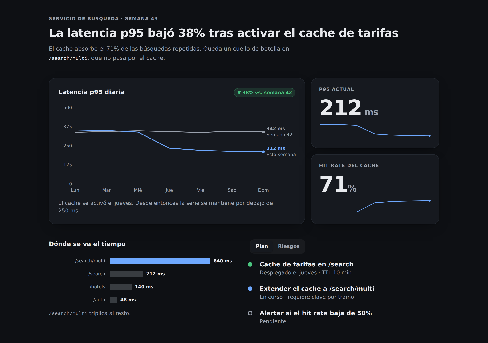
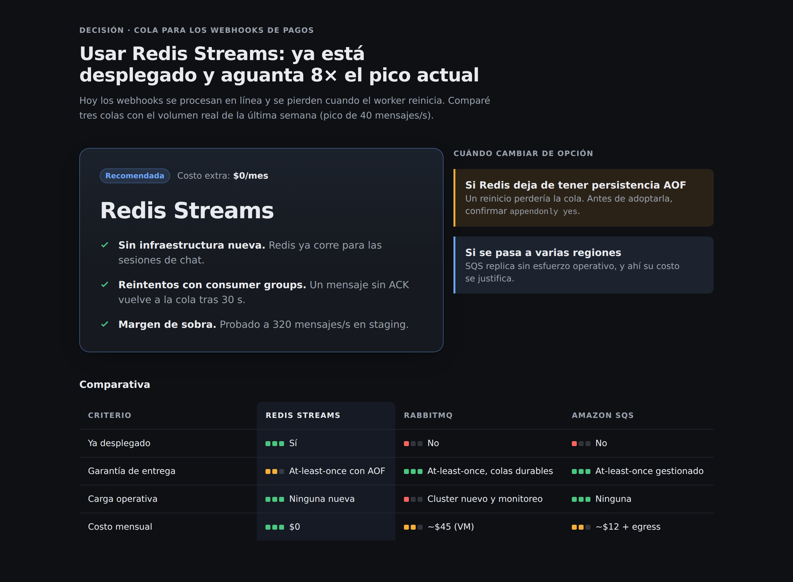
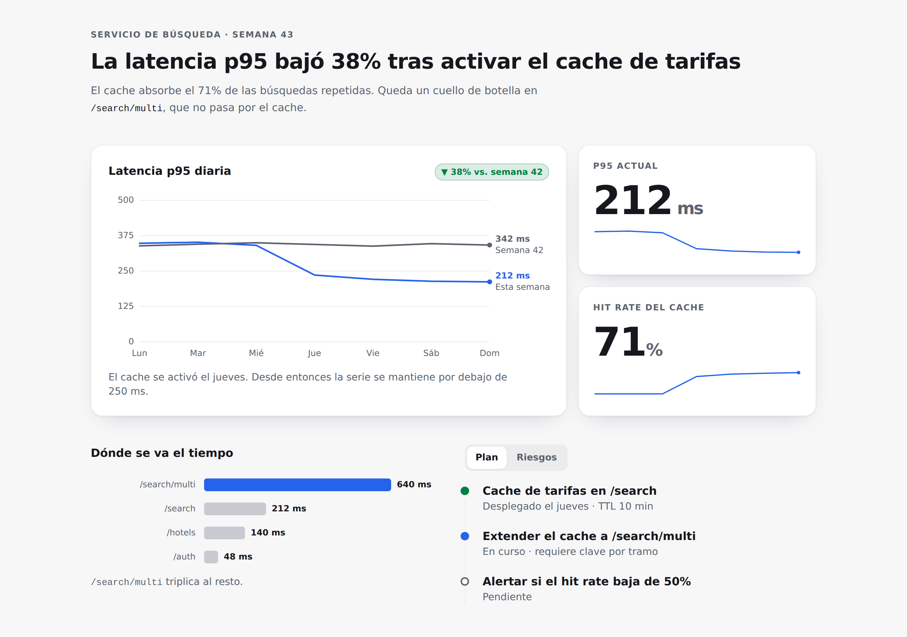
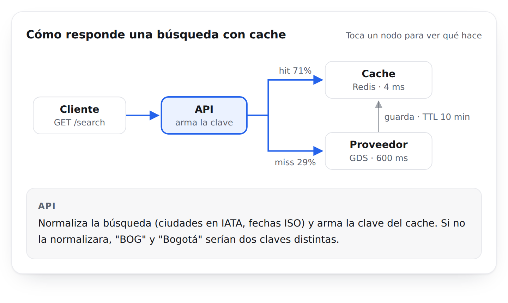
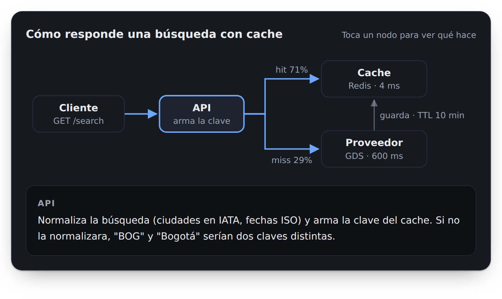
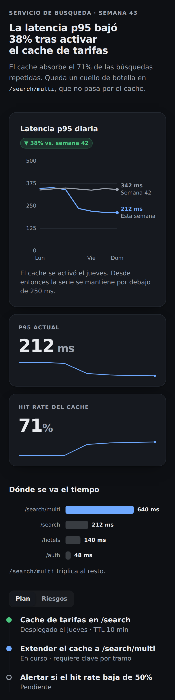

# Visual Artifacts para Google Antigravity

Una skill + una regla que hacen que Antigravity entregue **artifacts HTML diseñados** (reportes,
comparativas, diagramas interactivos, dashboards) en lugar de documentos Markdown o tarjetas
genéricas de Tailwind.



> *English: a skill + always-on rule for Google Antigravity that makes the agent ship designed HTML
> artifacts (reports, comparisons, interactive diagrams) instead of Markdown. Instructions are in
> Spanish; the agent follows them regardless of the language you chat in.*

## Por qué existe

Antigravity ya sabe renderizar HTML: trae la skill integrada `generative_ui`. Pero tiene dos huecos:

1. **"Artifact" significa Markdown por defecto.** Si pides *"haz un artifact comparando 3 ideas"*, el
   agente escribe un `.md` y ni considera el HTML.
2. **La guía de diseño es mínima.** `generative_ui` explica la mecánica (archivo, CSP, tokens del
   tema) pero en diseño solo dice *"aim for a clean, premium aesthetic"*. Además el CSP bloquea todos
   los CDN (sin Chart.js, Mermaid ni Google Fonts), así que sin instrucciones el modelo deja de
   dibujar gráficas.

Este repo cubre ambos: una **regla siempre activa** que convierte "artifact" en HTML, y una **skill**
con un método de diseño, componentes, gráficas en SVG puro, ejemplos y scripts de verificación.

## Galería

Todas las imágenes son los ejemplos de referencia de la skill, renderizados con los tokens de tema que
inyecta Antigravity.

| Comparativa con veredicto | Reporte en tema claro |
|---|---|
|  |  |

| Diagrama inline interactivo (tocar un nodo muestra su detalle) | Móvil (375px) |
|---|---|
|   |  |

## Instalación

Requisitos: Google Antigravity con la skill integrada `generative_ui` (probado en 2.26) y Python 3.9+
para los scripts de verificación.

### Linux, macOS o WSL

```bash
git clone https://github.com/NotProgram/antigravity-visual-artifacts.git
cd antigravity-visual-artifacts
./install.sh
```

### Windows (PowerShell)

```powershell
git clone https://github.com/NotProgram/antigravity-visual-artifacts.git
cd antigravity-visual-artifacts
powershell -ExecutionPolicy Bypass -File .\install.ps1
```

El instalador copia la skill a `~/.gemini/config/skills/visual-artifacts/` y la regla a
`~/.gemini/config/rules/visual-artifacts.md` (en Windows, `%USERPROFILE%\.gemini\config\...`).

> **Antigravity en WSL o remoto:** instala donde corre el agente. Si Antigravity usa un servidor en
> WSL (rutas `/home/...` en sus conversaciones), ejecuta `./install.sh` dentro de WSL; si corre en
> Windows nativo, usa `install.ps1`. En caso de duda, instala en ambos.

### Solo para un proyecto

```bash
./install.sh --workspace /ruta/a/tu/proyecto        # crea <proyecto>/.agents/skills y .agents/rules
```
```powershell
.\install.ps1 -Workspace C:\ruta\a\tu\proyecto
```

Puedes versionar esa carpeta `.agents/` para que todo tu equipo la tenga.

### Instalación manual

1. Copia `skills/visual-artifacts/` a `~/.gemini/config/skills/visual-artifacts/`.
2. Copia `rules/visual-artifacts.md` a `~/.gemini/config/rules/visual-artifacts.md` y reemplaza
   `{{SKILL_MD}}` por la ruta absoluta de `SKILL.md` instalado.

### Comprobar que funciona

1. Abre una **conversación nueva** (las reglas se cargan al empezar).
2. Pide algo como: *"haz un artifact comparando estas 3 opciones: …"*.
3. Deberías ver que el agente lee `generative_ui`, la skill y un ejemplo, escribe un `.html`,
   ejecuta `check_artifact.py` y `screenshot.py`, y te entrega el artifact en el panel lateral.

### Capturas automáticas (opcional, recomendado)

`screenshot.py` permite al agente ver su propio artifact en escritorio, tema claro y móvil, y detectar
desbordes horizontales. Necesita un Chromium; el más fiable para móvil es el headless shell de Playwright:

```bash
npx playwright install chromium-headless-shell
```

También detecta Chrome, Chromium o Edge instalados, o el que indiques en la variable `VA_CHROME`.

### Desinstalar

```bash
./install.sh --uninstall
```
```powershell
.\install.ps1 -Uninstall
```

## Qué incluye

```text
rules/visual-artifacts.md            regla always_on: "artifact" = HTML, y qué leer antes de escribirlo
skills/visual-artifacts/
├── SKILL.md                         método en 5 pasos: forma → dirección → jerarquía → contenido → verificación
├── references/
│   ├── design-system.md             tokens sobre el tema del host, KPI, badges, callouts, tabs, timeline, tablas
│   └── charts-and-diagrams.md       barras, línea con tooltip, donut, sparkline y diagramas en SVG sin librerías
├── examples/
│   ├── report.html                  reporte / dashboard
│   ├── decision.html                comparativa de opciones con veredicto
│   └── inline-diagram.html          diagrama interactivo compacto para dentro del chat
└── scripts/
    ├── check_artifact.py            linter: CDN bloqueados, texto < 12px, colores que rompen el tema, relleno…
    ├── preview.py                   copia con los tokens del host simulados y botón de tema
    └── screenshot.py                capturas escritorio/claro/móvil + detector de desborde con culpable
```

## Cómo funciona

1. La **regla** (`trigger: always_on`) se inyecta en cada conversación. Cambia la interpretación
   por defecto de "artifact" y le da al agente la ruta absoluta de la skill.
2. La **skill** le obliga a decidir la forma del contenido, fijar una dirección visual concreta,
   construir con un elemento dominante y contenido real, y partir del ejemplo más cercano.
3. Los **scripts** cierran el ciclo: el agente valida el HTML, mira capturas de su propio resultado
   y corrige antes de entregar.

## Limitaciones conocidas

- **La calidad final depende del modelo.** La skill guía mucho, pero un modelo pequeño puede saltarse
  pasos. Si pasa, el transcript de la conversación (`~/.gemini/antigravity/brain/<id>/.system_generated/logs/`)
  muestra qué leyó y qué no.
- **Los tokens de tema del preview son una aproximación** de los que inyecta Antigravity; sirven para
  revisar, no son idénticos.
- **Descubrimiento de skills globales.** Hay [reportes](https://discuss.ai.google.dev/t/bug-report-agent-is-unaware-of-global-skills-due-to-missing-path-in-system-prompt/127260)
  de que Antigravity no siempre encuentra las skills globales; por eso la regla incluye la ruta absoluta.

## Licencia

[MIT](LICENSE)
